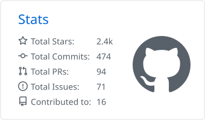
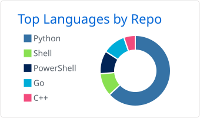

**Loading error, code: 404**

**XiaoliChan** · `::/0`

Red-Teamer

---

### `$ whoami`

Red-teamer focused on **Active Directory attacks, red-team
infrastructure and exploit development**. I spend most of my time building attack
tooling — mostly in **Python and Go**, some PowerShell — and exploring automated
security workflows with AI agents and local LLMs.

`OSCP+ (OffSec 2025)` · `Alibaba Cloud Security ACA (2026)`

### `$ ls ~/featured`

| | project | |
|:---|:---|:---|
|  | **[wmiexec-Pro](https://github.com/XiaoliChan/wmiexec-Pro)** | new generation of wmiexec.py |
|  | **[wmiexec-RegOut](https://github.com/XiaoliChan/wmiexec-RegOut)** | output via registry, no SMB needed |
|  | **[RedCaddy](https://github.com/XiaoliChan/RedCaddy)** | C2 redirector based on Caddy |
|  | **[zerologon-Shot](https://github.com/XiaoliChan/zerologon-Shot)** | Zerologon with automatic DC password restore |
|  | **[available-ipv6-hosts](https://github.com/XiaoliChan/available-ipv6-hosts)** | IPv6 hosts |
|  | **[LDAPShell](https://github.com/XiaoliChan/LDAPShell)** | ldap_shell.py wrapper for ntlmrelayx |
| `new` | **[hatstack](https://xiaolichan.github.io/hatstack/)** | search every Black Hat briefing, 1997–today |

### `$ stats`

<table>
  <tr>
    <td width="60%">
      <picture>
        <source media="(prefers-color-scheme: dark)" srcset="profile-summary-card-output/github_dark/3-stats.svg">
        
      </picture>
    </td>
    <td width="40%">
      <picture>
        <source media="(prefers-color-scheme: dark)" srcset="profile-summary-card-output/github_dark/1-repos-per-language.svg">
        
      </picture>
    </td>
  </tr>
</table>

### `$ lab`

